# RustTune

An audio-only, gamepad-first YouTube Music player built with Rust and Slint for the **Anbernic RG35XX H** running **ROCKNIX** and **PortMaster** (640x480). Ships as a single self-contained `aarch64` binary with pure-Rust AAC decoding (`symphonia`), embedded Svelte 5 + Vite Web UI, and zero bundled FFmpeg or mpv libraries.

> **Hardware Support Note:** Working on ROCKNIX with an RG35XX H. Currently I only have an RG35XX H with me, so I will not be able to test it out on other handhelds.
>
> **AI / LLM Disclosure:** LLMs were used to varying degrees for this project.
>
> **License:** You are allowed to fork, distribute, and modify this code without attribution (`MIT-0`, Copyright 2026 `dfrost16`).

## Features

- **UI:** A clean beautiful UI made with RG35XX H in mind.
- **Themes:** Dynamic theming based on cover art, plus Studio Dark and Studio Light modes (and `#000000` AMOLED mode on mobile web).
- **Lyrics:** Support for time-synced 3-line lyrics via LRCLIB with YouTube Music plain lyrics fallback.
- **Navigation:** Navigate your Library, history, or artists, or just enjoy music based on mood (Vibes).
- **Pocket Lock:** A minimal black screen pocket mode (`L3`) to save battery while audio keeps playing.
- **Web UI:** A polished local Web UI secured by a 6-digit pairing PIN to manage playlists, import YouTube playlists by URL, and delete offline `.m4a` files, optimised for both phone and desktop.

## Screenshots

### Handheld (640x480 RG35XX H)

| Now Playing & Synced Lyrics | Vibes (Moods & Genres) |
| :---: | :---: |
| 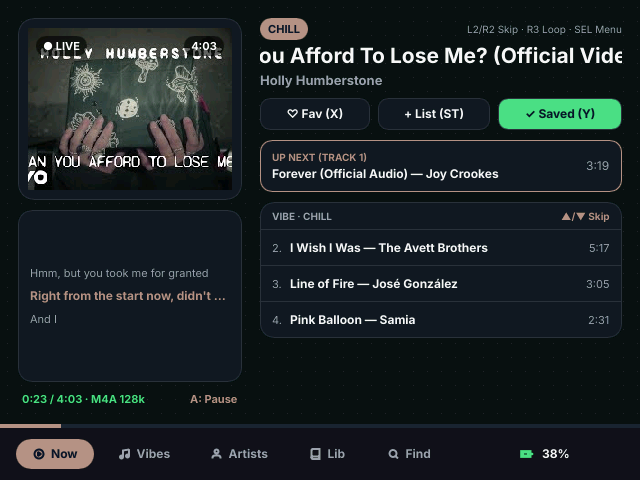 | 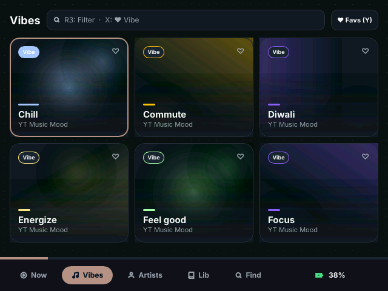 |

| Artists Grid | Search Keyboard |
| :---: | :---: |
| 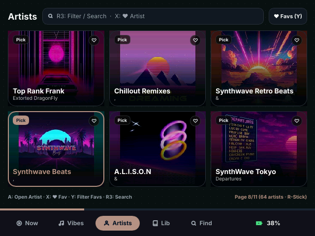 | 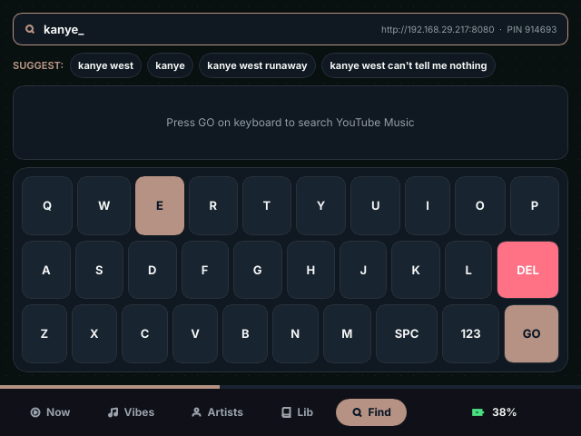 |

| Playlists Modal | Settings & Security PIN |
| :---: | :---: |
| 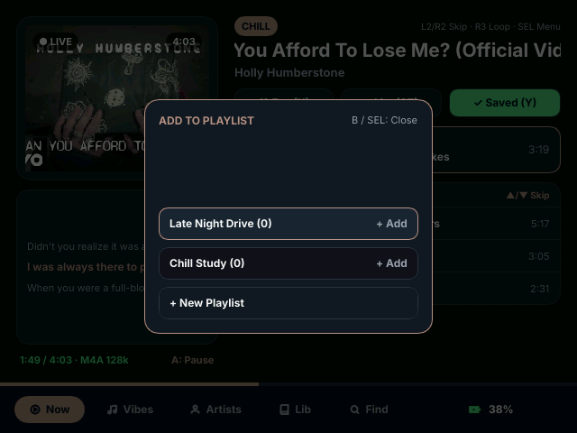 | 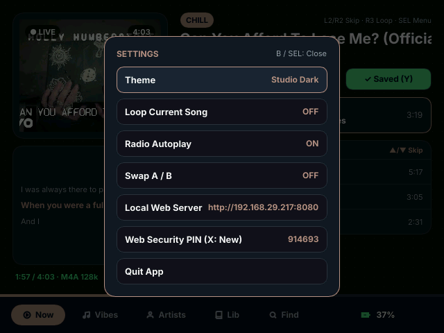 |

### Local Web UI

| Desktop Command Workbench |
| :---: |
| 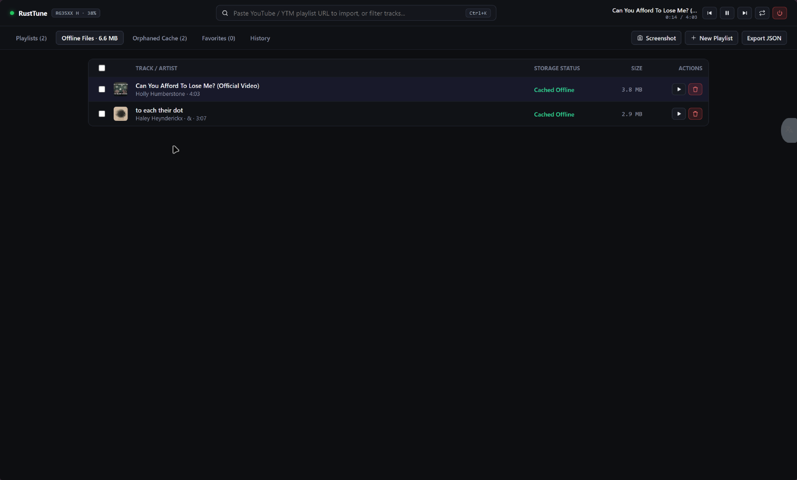 |

| Phone Now Playing (AMOLED) | Phone Library | Phone YouTube Import | Phone Offline Files |
| :---: | :---: | :---: | :---: |
| 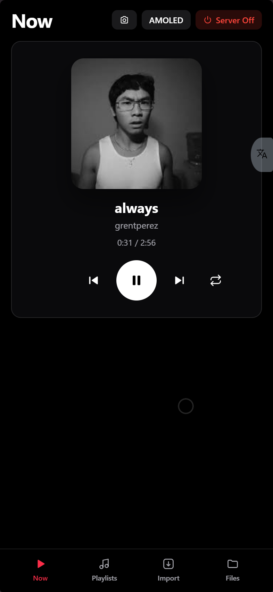 | 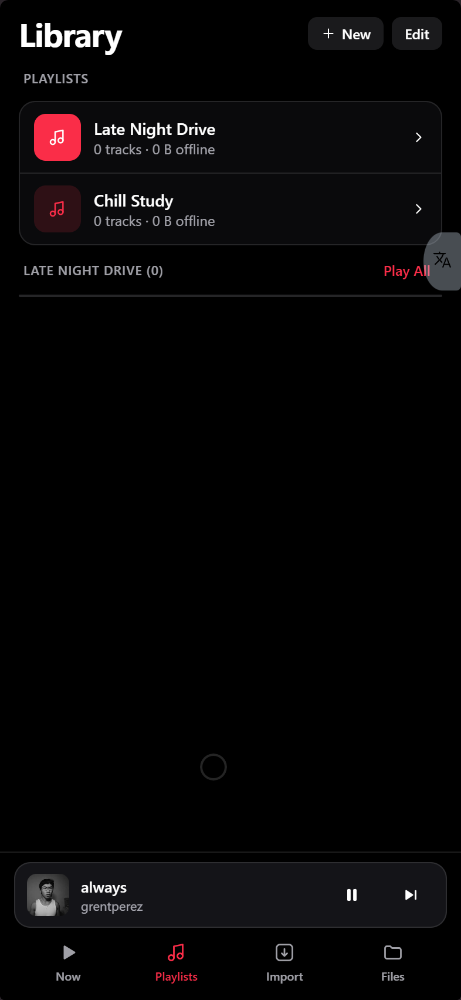 | 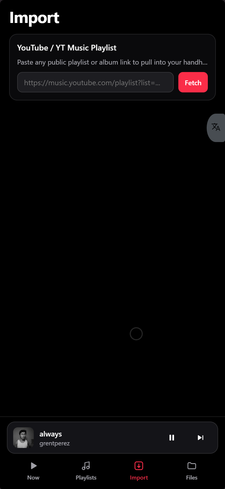 | 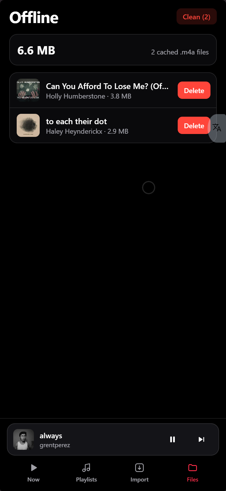 |

## Controls (RG35XX H)

| Screen | Button | Action |
|---|---|---|
| **Global** | `L1` / `R1` | Switch dock tabs (`Now`, `Vibes`, `Artists`, `Lib`, `Find`) |
| | `L2` / `R2` | Previous / Next track from any screen |
| | `SELECT` | Open / close Settings (Theme, Loop, Radio Autoplay, Swap A/B, Local Web Server, Web Security PIN, Quit) |
| | `L3` | Toggle Pocket Lock (`L3` or `START` unlocks) |
| | `START` | Add selected/current track to a Playlist |
| **Now Playing** | `A` | Play / Pause |
| | `D-Pad Left` / `Right` | Seek -10s / +10s |
| | `R-Stick Left` / `Right` | Seek -30s / +30s |
| | `D-Pad Up` / `Down` | Previous / Next track |
| | `R3` | Loop current song ON / OFF |
| | `X` / `Y` | Toggle Favorite / Download `.m4a` offline |
| **Vibes & Artists** | `D-Pad` | Navigate 3x2 grid cards |
| | `R-Stick Up` / `Down` | Jump pages fast |
| | `A` | Open Vibe mix or Artist page |
| | `X` / `Y` | Favorite card / Toggle Favorites Only |
| | `R3` | Open search/filter keyboard |
| **Library (`Lib`)** | `D-Pad Left` / `Right` or `R-Stick L/R` | Switch sub-tabs (`Favs`, `Playlists`, `History`, `Downloads`) |
| | `D-Pad Up` above row 0 | Focus header action (`Clear` all downloads in Downloads) |
| | `R-Stick Up` / `Down` | Jump +/- 5 rows |
| | `A` / `X` / `Y` | Play track / Toggle Favorite / Download (or Delete file in Downloads) |
| | `R3` | Filter current Library view |
| **Detail Pages** | `D-Pad Up` above row 0 | Focus `[Download All]` button (`A` opens confirmation modal) |
| | `D-Pad L/R` or `R-Stick L/R` | Switch `Songs / Albums / Singles` on Artist Detail |
| **Find / Keyboard** | `D-Pad` | Navigate keys (`Up` from top row enters Hits / Suggestions) |
| | `R3` | Toggle `ABC` / `123` number & symbol layout |
| | `A` / `X` / `Y` | Press key / Space / Backspace |

## Build & Cross-Compile Guide

### Prerequisites

- **Node.js (v20+) & npm:** Used to build the Svelte 5 + Vite web frontend before embedding it into the Rust binary.
- **Rust (`rustup`):**
  ```powershell
  rustup target add aarch64-unknown-linux-gnu
  ```
- **Zig + `cargo-zigbuild` (for Windows/macOS cross-compilation to ROCKNIX glibc 2.36):**
  ```powershell
  cargo install cargo-zigbuild
  # Plus install Zig (e.g., `winget install zig.zig` on Windows or `brew install zig` on macOS)
  ```
  *Why Zig?* `cargo-zigbuild` cross-compiles C dependencies (`rusqlite` bundled SQLite) to `aarch64-unknown-linux-gnu` without needing Docker or manual Linux sysroots, while pinning `glibc 2.36` ABI compatibility for ROCKNIX. On native ARM64 Linux or Ubuntu CI runners (`ubuntu-24.04-arm`), standard `cargo build --release` works as well.
- **Python 3:** Used by `build_port.py` to generate fallback cover icons, enforce LF line endings on `RustTune.sh`, and bundle `dist/rusttune.zip`.

### Build Steps

1. **Build the Web UI assets** (embedded at compile time by `ytmusic-rs/build.rs`):
   ```powershell
   cd webapp
   npm install
   npm run build
   cd ..
   ```

2. **Run tests and cross-compile the RG35XX H binary:**
   ```powershell
   cd ytmusic-rs
   cargo test
   cargo zigbuild --release --target aarch64-unknown-linux-gnu.2.36
   cd ..
   ```

3. **Package PortMaster zip:**
   ```powershell
   python build_port.py
   ```
   Outputs `dist/rusttune.zip` ready for PortMaster (`autoinstall/` or manual extraction to your ports directory).
